# AIDocuments

Document management for PDFs: the application collects PDF files and photos from IMAP mailboxes, a watched import
folder or by upload, has an AI index them (title, summary, document type, correspondent, date, tags, key facts – and
for scans the full text as well) and makes them searchable.

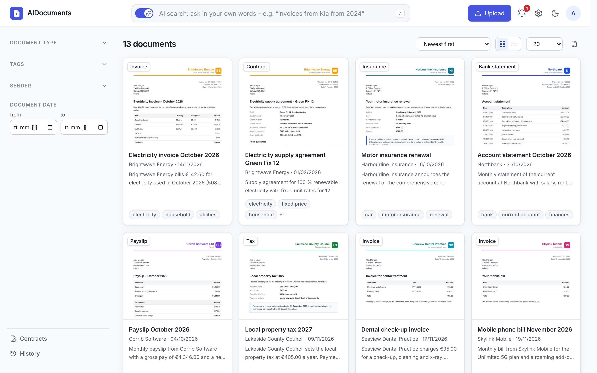

## Highlights

- **Modern, simple interface** – one search box, filters that stay out of the way, grid and list view with
  thumbnails, light and dark theme, 36 languages. Everything is configured in the browser; there are no
  configuration files to edit.
- **Local installation** – AIDocuments runs on your own computer or server as a single Docker container. PDFs,
  database, search index and keys live in one directory that you control and back up.
- **Data security** – access only after sign-in, with separate roles for administrators and users. Passwords are
  stored as hashes, mailbox passwords and API keys encrypted (AES-256-GCM). Mailboxes are read without changing
  them. An AI in the cloud is used only if you choose one yourself – the interface says so clearly – and a local
  AI server keeps the contents of your documents inside your network.
- **No telemetry** – no analytics, no tracking, no usage statistics, no fonts or scripts loaded from third
  parties. The application connects only to the mailboxes and to the AI server you have configured.
- **Text recognition included** – the Docker image ships Tesseract, which reads scanned PDFs, so they are
  full-text searchable from the first start, without any AI service and without your documents leaving the
  machine.

## Screenshots

All documents shown are fictional samples (see [Development](#development)). Click a picture to enlarge it.

| | |
|:-:|:-:|
| [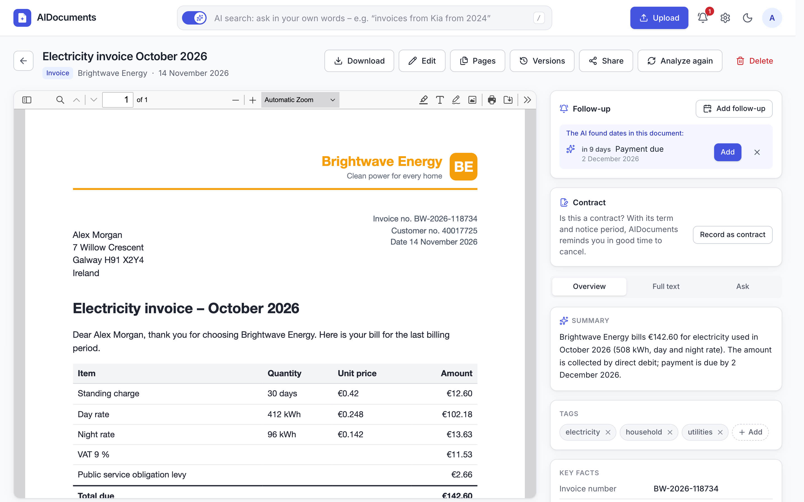](docs/screenshots/document.png)<br>**Document page** – PDF viewer, summary, key facts and a deadline the AI found | [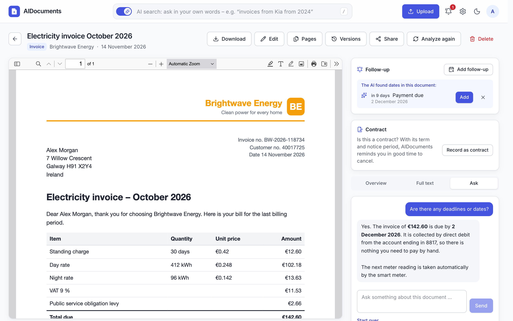](docs/screenshots/ask.png)<br>**Ask** – questions about a document, answered from its content |
| [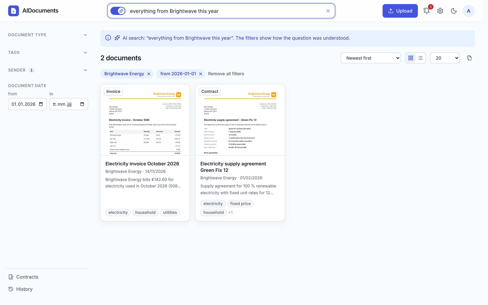](docs/screenshots/ai-search.png)<br>**AI search** – a question in your own words becomes filters | [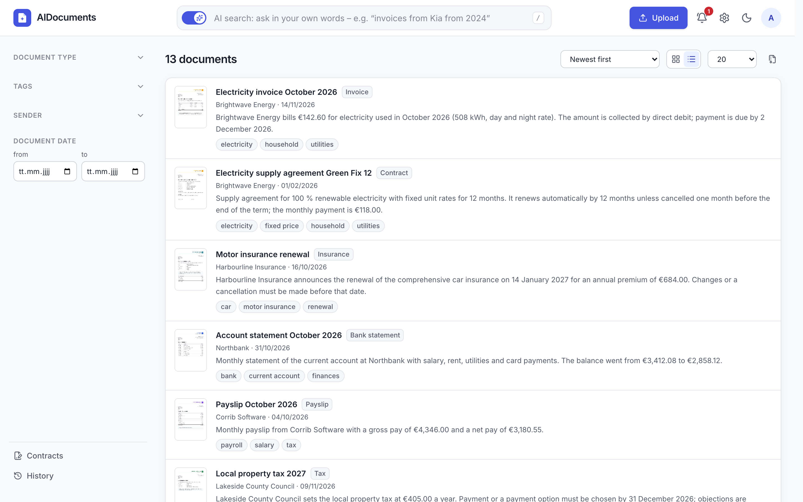](docs/screenshots/documents-list.png)<br>**List view** |
| [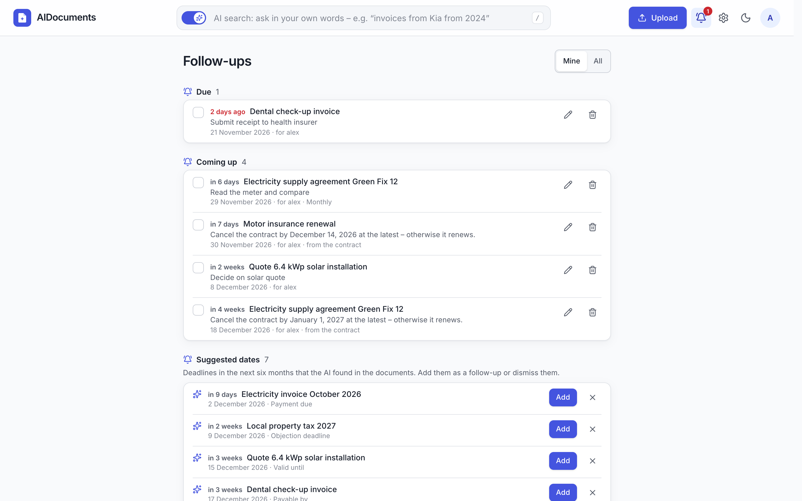](docs/screenshots/reminders.png)<br>**Follow-ups** – due, coming up and suggested by the AI | [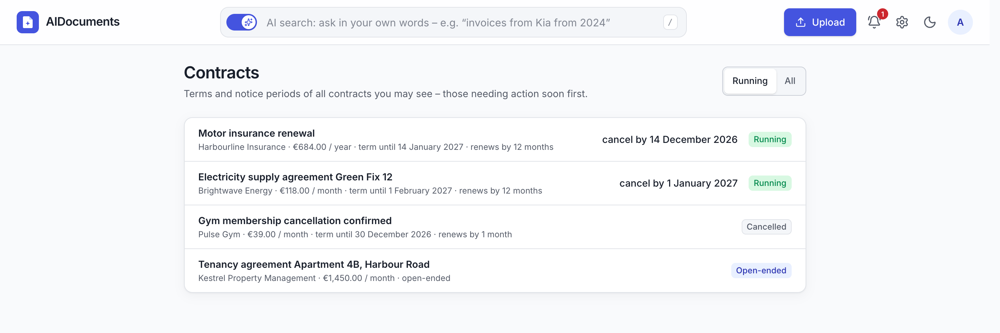](docs/screenshots/contracts.png)<br>**Contracts** – notice deadlines at a glance |
| [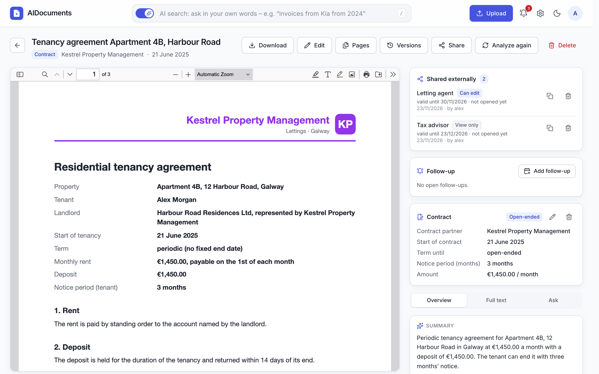](docs/screenshots/shared-document.png)<br>**Sharing** – links for people without an account, plus contract details | [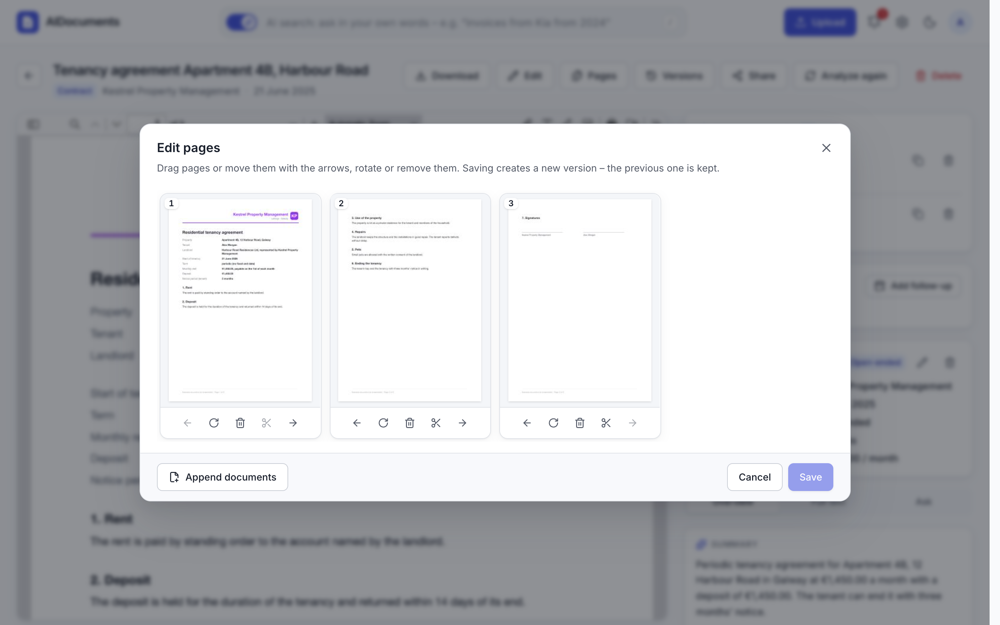](docs/screenshots/edit-pages.png)<br>**Edit pages** – reorder, rotate, remove, split |
| [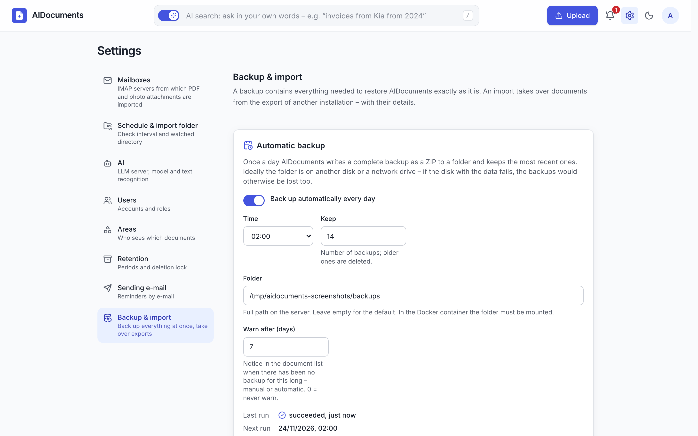](docs/screenshots/settings-backup.png)<br>**Automatic backup** – nightly into a folder of your choice | [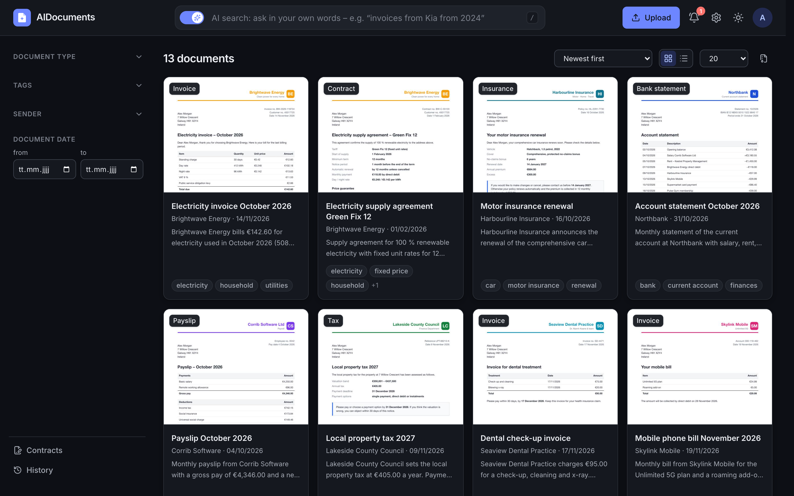](docs/screenshots/documents-dark.png)<br>**Dark theme** |

## Technology

- **Backend:** Spring Boot 4 (Java 21), SQLite (built in) or MariaDB, Apache Lucene (full-text search), PDFBox,
  Anthropic Java SDK, a custom client for OpenAI-compatible servers
- **Frontend:** React 19, TypeScript, Vite, Tailwind CSS 4, TanStack Query

## Features

| Area | What the application does |
|---|---|
| Intake | PDF attachments from IMAP mailboxes (read-only – e-mails stay unchanged and unread; optionally only e-mails whose subject and sender match a filter, see [Mailbox filter](#mailbox-filter)), new files from a watched folder, upload by button or drag & drop (several files at once). Photos (JPG, PNG, HEIC) become one-page PDFs – see [Photos](#photos). Files with identical content are recognised and not stored twice; the same letter scanned twice is marked as a possible duplicate (see [Duplicates](#duplicates)). |
| AI | Summary, document type, correspondent, document date, tags and key facts (amounts, deadlines, numbers …). Existing tags and correspondents are reused. Scans without a text layer are transcribed and thus become full-text searchable – by the built-in text recognition as long as no AI is set up. |
| Search | Full text across content, title, tags, correspondent and key facts – with German stemming, results while typing and partial matches in the middle of a word. Filters for document type, tags, correspondent and period (collapsible). With an AI set up, the search box also understands questions in natural language – see [AI search](#ai-search). |
| View | Grid and list view with thumbnails, detail page with PDF viewer, light and dark theme. Metadata can be edited by hand; tags can be removed and added directly on the document. |
| Edit | Highlight, add text, draw, insert images or sign directly in the PDF viewer and save the changes. Reorder, rotate and remove pages, split a document in two or append others to it. The original is always kept and can be downloaded or restored at any time. |
| Areas | Admins group documents into areas and decide who may read, edit or delete in which one; mailboxes and the import folder file into an area of their own. See [Areas](#areas). |
| Retention | Retention periods per document type: until the period has ended nobody can delete the document, not even an administrator. See [Retention periods](#retention-periods). |
| Reminders | Follow-up dates on documents – suggested by the AI from deadlines in the document, confirmed or set by hand, assigned to a person, once or recurring. A *Due* list with a counter in the header, and an e-mail to the assignee when a reminder is due. See [Reminders](#reminders). |
| Contracts | Term, notice period and automatic renewal of a contract – a reminder in good time before the notice deadline, and an overview of all contracts. See [Contracts](#contracts). |
| Notifications | Optional daily e-mail with new documents; administrators are told when retention periods have ended and when a mailbox keeps failing. See [E-mail notifications](#e-mail-notifications). |
| Export | All documents of the current list (search and filters included) as a ZIP file with the PDFs and their details as CSV and JSON. See [Export](#export). |
| Backup & import | A complete backup as a ZIP file at the push of a button or automatically every night into a folder (keeping the newest ones, with a warning when the last backup is too old), and import of an export – from this or another installation – without the AI reading the documents again. See [Backup and import](#backup-and-import). |
| Share | Send a link to one document to someone without an account – view only or with permission to edit, valid for a chosen period, revocable at any time. The document page shows with whom it is shared. See [Sharing documents](#sharing-documents). |
| Ask | With an AI set up, ask questions about an open document (“When is the payment due?”) – answered from its content. |
| Users | Initial setup with an administrator account, further accounts with the roles **Admin** and **User**; two-factor authentication with an authenticator app (mandatory for administrators); sign-in with a passkey. See [Passkeys](#passkeys). |
| Settings | Mailboxes (each with its own check interval if you like), check interval and import folder, AI/LLM server, users, areas, retention periods, outgoing e-mail, backup – all in the user interface. |
| Languages | User interface and server messages in 36 European languages. The first start uses the system language, English if there is no matching translation; switchable in the user menu. See [Languages](#languages). |

### Roles

| | User | Admin |
|---|:-:|:-:|
| View, search and download documents, ask questions, export as ZIP, reminders | read | ✓ |
| Upload, edit metadata, annotate PDFs and edit pages, versions, share links, contracts | edit | ✓ |
| Move documents to the trash (once their retention period has ended) and restore them | delete | ✓ |
| Analyze documents again | | ✓ |
| Settings (mailboxes, schedule, AI, retention periods, outgoing e-mail, backup), users and areas | | ✓ |

Users see only the documents of the [areas](#areas) they belong to, and what they may do there depends on their
permission in that area (*read*, *edit* or *delete*); administrators see all areas and may do everything.

### Search

| Input | finds |
|---|---|
| `invoice electricity` | documents containing both words (also “invoices”) |
| `insurance` | also “reinsurance” – parts of words count |
| `"payable by"` | exactly this sequence of words |
| `rent -deposit` | “rent”, but not “deposit” |
| `electricity \| gas` | either of the two |

### AI search

If an AI is set up, the search box works in two modes; the icon on its left switches between them, and the browser
remembers the choice:

- **AI search** (sparkle icon, the default): type a question such as *“invoices from Kia from 2024”* and press
  Enter. The AI translates it into the regular filters – keywords, document type, correspondent, tags, period – and
  the list shows the result. The filter chips show how the question was understood and can be adjusted by hand.
  Document types, correspondents and tags are only used if they exist in your library; anything else becomes a
  search term, so a misunderstanding never hides documents.
- **Keyword search** (magnifier icon): the full-text search above, with results while typing.

Without an AI the search box is always a keyword search.

## Development

Requirements: Java 21, Node.js 22+. No database server is needed – the backend keeps its data in an SQLite file
(`backend/data/aidocuments.db`).

```bash
# 1. Start the backend (http://127.0.0.1:8080)
cd backend && ./mvnw spring-boot:run

# 2. Start the frontend (http://127.0.0.1:5173, forwards /api to the backend)
cd frontend && npm install && npm run dev
```

On the first visit to <http://127.0.0.1:5173> the application asks for the name and password of the
administrator account, together with the **setup code** that the backend prints to its log on startup. The code
makes sure that only someone with access to the server can claim a freshly started instance.

**LLM server of the debug build:** If `backend/config/debug.yml` exists, it is loaded automatically on a local
start (template: `backend/config/debug.example.yml`). The file is not in Git and does not end up in the Docker
image – the right place for the server address and API key of the development environment.

Tests:

```bash
cd backend && ./mvnw test
```

The integration test runs through initial setup, roles, upload, search, IMAP retrieval (against an embedded
test mail server) and the import folder – once against the built-in SQLite database and once more against a
real MariaDB (Testcontainers, needs a running Docker).

User interface tests ([Playwright](https://playwright.dev)):

```bash
cd frontend && npm run test:e2e
```

They start a throwaway instance of their own – a backend on port 8091 with an empty temporary data directory (built
with `./mvnw package -DskipTests` if `backend/target/aidocuments-backend-0.1.0.jar` is missing) and the Vite dev
server on port 5198 – create test accounts (an administrator with two-factor sign-in, a user with view-only access
to an area) and generated PDFs, and delete everything afterwards; a running installation is not touched. They cover
sign-in, contracts and the reminder they create, editing pages, the read-only view, e-mail notification settings,
the automatic backup with its warning, and passkeys (with a virtual authenticator in the test browser – nothing is
stored on the computer). By default they use the installed Google Chrome; `AIDOCS_E2E_BROWSER=chromium` uses
Playwright's own Chromium (`npx playwright install chromium` first). The report of the last run is in
`frontend/playwright-report/`.

The screenshots in `docs/screenshots/` are made the same way:

```bash
cd frontend && npm run screenshots
```

This starts a throwaway instance on ports 8093 (backend) and 5197 (user interface) with thirteen English sample
documents of fictional companies, printed to PDF by Chrome, plus a small stand-in for the AI on port 8094 that returns
prepared results – no language model is needed and none is contacted. All dates are relative to the day of the run,
so deadlines always lie ahead. The pictures are taken in English at 1440 × 900 (2× scale), one of them in dark mode.
On macOS, Chrome shows the placeholder of date fields in the language of the operating system.

## Production with Docker

One image contains the user interface, the backend, the built-in text recognition (Tesseract) and the built-in
database (SQLite).

### Option A: built-in database

```bash
docker compose up -d --build
```

Without `AIDOCS_DB_URL` the application keeps its data in an SQLite file – nothing else to install or run.
Everything persistent lives in the volume `/aidocuments`:

```
/aidocuments
├── aidocuments.db  database (only with the built-in database)
├── files/          the PDF files
├── thumbnails/     thumbnails
├── index/          search index (rebuilt from the database when needed)
└── secret.key      key for stored mailbox passwords and API keys
```

### Option B: external MariaDB

```bash
echo "MARIADB_PASSWORD=$(openssl rand -base64 24)" > .env   # once – the compose file refuses to start without it
docker compose -f docker-compose.mariadb.yml up -d --build
```

With `AIDOCS_DB_URL` set, the application uses an existing MariaDB (10.6 or newer). The database has to exist;
the application creates its tables on the first start. The volume `/aidocuments` is still needed (PDFs, search
index, key file).

```bash
docker run -d -p 8080:8080 \
  -e AIDOCS_DB_URL='jdbc:mariadb://db.example.com:3306/aidocuments' \
  -e AIDOCS_DB_USER=aidocuments -e AIDOCS_DB_PASSWORD='…' \
  -v aidocuments-data:/aidocuments \
  aidocuments
```

### Import folder

Mount the scanner's folder as `/import` (`-v /path/to/scan-folder:/import`) – the image is preconfigured to
use it as the import folder. Switch it off or change it under *Settings → Schedule & import folder*.

### Backup

With the built-in database, *Settings → Backup* downloads a complete backup while the application keeps running,
or writes one automatically every night – see [Backup and import](#backup-and-import). For the automatic backup,
mount a folder on another disk or a network drive, e.g. `-v /mnt/nas/aidocuments-backups:/backups`, and set
`AIDOCS_BACKUP_DIR=/backups` (or enter `/backups` in the settings). Otherwise back up `/aidocuments` – with an external MariaDB the
database as well. Stop the container before copying the directory, so the built-in database is not copied in the
middle of a write. The file `secret.key` belongs in the backup: without it, stored mailbox passwords and API keys
can no longer be decrypted.

### First start

As long as no account exists, the application prints a one-time **setup code** to its log
(`docker compose logs aidocuments`). The setup page asks for it along with the administrator account – without
the code nobody can take over an instance that is already reachable from the internet before you set it up.

### Behind a reverse proxy (HTTPS)

The application itself speaks HTTP. Before making it reachable from the internet, put a reverse proxy with TLS in
front of it (Caddy, nginx, Traefik …) and do not publish port 8080 to the internet itself – for example
`ports: ["127.0.0.1:8080:8080"]` when the proxy runs on the same host, or no `ports` at all when it runs in the
same Docker network. On Linux, ports published by Docker bypass host firewalls such as ufw, so a "deny 8080" rule
does not protect a plain `"8080:8080"`.

Behind a proxy, `AIDOCS_TRUSTED_PROXIES` is **required** – it tells the application which proxy it may trust:

- a comma-separated list of IP addresses (no ranges). For a proxy in the same Docker network, its container
  address, e.g. `AIDOCS_TRUSTED_PROXIES=172.18.0.5`. For a proxy on the host with
  `ports: ["127.0.0.1:8080:8080"]`, the address of the Docker gateway as seen from the container (e.g. `172.17.0.1`).
- `private` – any address from a private network (10.x, 172.16–31.x, 192.168.x, localhost). Convenient in Docker
  networks, as long as port 8080 is **not** published and nobody else on those networks can reach the
  application directly – they could fake their IP address.

Only from those addresses does the application take `X-Forwarded-For`, `X-Forwarded-Proto`, `X-Forwarded-Host` and
`X-Forwarded-Port` into account: cookies are marked `Secure`, HSTS is sent, and the sign-in lockout sees the
browser's IP address. Without the variable, every browser appears with the proxy's address, and 20 failed sign-ins
would pause sign-in for everyone for 15 minutes; the log warns once when forwarded headers arrive from an address
that is not listed. Entries that are not IP addresses stop the start with an error.

Built-in protection:

- **Initial setup:** only with the one-time setup code from the server log.
- **Two-factor authentication:** mandatory for administrators – after signing in, an administrator without it can
  only set it up; the server refuses everything else until then, and administrators cannot switch it off. Users can
  switch it on in the user menu. Any authenticator app works (e.g. Google Authenticator, Microsoft Authenticator,
  1Password, Aegis). Sign-in then also asks for the six-digit code; ten one-time recovery codes help if the phone is
  lost, and an administrator can reset it for an account (an administrator then sets it up again at next sign-in).
- **Sign-in lockout:** per account and IP address (5 failed attempts in 5 minutes), per IP address (20 in
  15 minutes; IPv6 per /64 network) and per account overall (100 in an hour – addresses the account has already
  signed in from are exempt). This also covers parallel attempts. Whoever gets to the code step already knows the
  password, so wrong authenticator codes are limited further: ten per account in 24 hours (again with known
  addresses exempt), each one logged as a warning.
- **Confirmation for administration:** changes to accounts, mailboxes and settings need an authenticator code that
  is at most 10 minutes old (signing in with the code counts). An unattended administrator session alone is not
  enough to create accounts, reset passwords or two-factor authentication, or redirect the AI to another server;
  five wrong codes end the session.
- **Passkeys:** sign-in with a passkey counts as both factors; adding one needs the password or, with two-factor
  authentication, a current code. See [Passkeys](#passkeys).
- **Requests:** CSRF protection (token renewed at sign-in) and a strict Content Security Policy.
- **Sessions:** end when an account is changed, disabled or deleted, or its password is changed.
- **Stored secrets:** mailbox passwords and API keys are only used for the host name they were saved for, and
  not for a switch from encrypted to unencrypted.
- **PDFs:** scripts and XFA forms in the viewer are off; crafted files (compression bombs, gigantic pages) are
  rejected instead of exhausting memory.
- **Limits:** 50 MB per file uploaded in the browser (250 MB for edited PDFs, e-mail attachments and the import
  folder), 25 attachments (PDFs and photos) per e-mail, and a limit on AI requests per user (2 at a time, 60 per hour). Below
  1 GB of free disk space no new files or versions are accepted, so the database never runs out of space; mail
  import then pauses and picks up where it left off.

## Configuration

Almost everything can be set in the user interface. The environment variables are defaults for the start;
values saved in the user interface take precedence.

| Variable | Meaning | Default |
|---|---|---|
| `AIDOCS_DB_URL` | Database: empty = built-in SQLite file in the data directory; `jdbc:mariadb://host:3306/aidocuments` for an external MariaDB | built-in |
| `AIDOCS_DB_USER` / `AIDOCS_DB_PASSWORD` | Credentials for the external MariaDB | empty |
| `AIDOCS_DATA_DIR` | Storage for PDFs, search index, key file and the built-in database | `./data` (in the image: `/aidocuments`) |
| `AIDOCS_IMPORT_DIR` | Watched import folder | empty = off (in the image: `/import`) |
| `AIDOCS_BACKUP_DIR` | Default folder of the automatic backup (can be changed in the interface) | `backups/` in the data directory |
| `AIDOCS_IMPORT_INTERVAL` | General check interval (import folder and mailboxes without their own), e.g. `5m`; only until it is changed in the interface | `5m` |
| `AIDOCS_AI_PROVIDER` | LLM provider: `anthropic`, `openai`, `moonshot`, `lm-studio`, `openai-compatible` | `anthropic` |
| `AIDOCS_AI_BASE_URL` | Address of the LLM server | the provider's default address |
| `AIDOCS_AI_API_KEY` | API key of the LLM server (`ANTHROPIC_API_KEY` is read as well) | empty |
| `AIDOCS_AI_MODEL` | Model ID | `claude-opus-5-5` |
| `AIDOCS_OCR` / `AIDOCS_OCR_LANGUAGES` | Built-in text recognition – see [below](#built-in-text-recognition) | `on` / `deu+eng` |
| `AIDOCS_TRUSTED_PROXIES` | Reverse proxies whose `X-Forwarded-*` headers are trusted: IP addresses or `private` – required behind a proxy, see [above](#behind-a-reverse-proxy-https) | empty = none |
| `SERVER_ADDRESS` / `SERVER_PORT` | Bind address and port | `127.0.0.1` / `8080` (in the image: `0.0.0.0`) |

## AI integration

The provider is chosen under *Settings → AI*:

| Provider | Interface | Default address | Content leaves the machine |
|---|---|---|:-:|
| Anthropic | Anthropic Messages API | `https://api.anthropic.com` | yes |
| OpenAI | OpenAI Chat Completions | `https://api.openai.com/v1` | yes |
| Moonshot | OpenAI Chat Completions | `https://api.moonshot.ai/v1` | yes |
| LM Studio | OpenAI Chat Completions | `http://localhost:1234/v1` | no |
| OpenAI-compatible | OpenAI Chat Completions | freely selectable | depends on the server |

For Anthropic, OpenAI and Moonshot the user interface points out that document contents are transmitted to
servers on the internet for analysis, and recommends a local AI. A stored API key always belongs to exactly
one provider: when the provider changes, the key is discarded and never sent to the new provider.

How the document reaches the model:

- **Claude API** (Anthropic with the default address): the PDF goes to the model as a whole – layout, tables
  and scans included – and the result comes back as structured output.
- **All others** (the OpenAI interface, and the Anthropic interface in *compatibility mode* for self-hosted
  servers): the document goes to the model as extracted text or – for scans – as page images, and the result
  comes back as a tool call. The model therefore has to support tool calls (tool use / function calling) and,
  for scans, image input. Limits: of very long texts the AI evaluates only the beginning, of scans the first
  8 pages; the application notes this on the document. For text documents the full-text search still covers
  the entire text.

Every answer is checked (title, summary, document type, tags, date, and for scans the full text). If it cannot
be processed, the application asks exactly once more and tells the model what was missing. Documents go to the
model strictly one after another, never several at the same time.

**Long answers:** Models that “think” before answering (many local models do) use many times the size of the
actual answer for that – and the thinking counts against the same token limit. The application therefore
leaves plenty of room (16,000 tokens, 24,000 with text recognition). If an answer is cut off anyway, a second
attempt follows with twice the limit. If that is not enough either, or the server does not allow it, the
application keeps whatever arrived complete from the cut-off answer – provided title, summary, document type
and tags are complete. Only then does the analysis count as failed. For every cut-off the log states how many
tokens were generated and how much of that was thinking.

Without AI access the application keeps working: PDFs are stored and searchable through their text layer, only
summary and tags are missing. To analyze them later: *Settings → AI → “Analyze now”*.

### Asking questions about a document

The tab *Ask* on a document page answers questions about that document. The AI receives the document's details and
its full text (the beginning of very long documents) and answers only from them; it says so if the answer is not in
the document. The conversation stays in the browser and is not stored.

### Built-in text recognition

The Docker image contains [Tesseract](https://github.com/tesseract-ocr/tesseract) (Apache 2.0). As long as no AI
is set up, it reads every PDF that consists of images only (scans without a text layer), so these documents are
full-text searchable as well. It only provides the text – title, summary and tags still need an AI. As soon as
an AI is set up, that AI takes over text recognition.

Pages are rendered at 300 dpi and read one after another – a few seconds per page. At most the first 50 pages of
a document are read; the application notes on the document if there are more.

| Variable | Meaning | Default |
|---|---|---|
| `AIDOCS_OCR` | `off` switches the built-in text recognition off | `on` |
| `AIDOCS_OCR_LANGUAGES` | Languages of your documents as Tesseract codes joined with `+` | `deu+eng` |

The image contains the languages German, English, French, Italian, Spanish and Dutch (`deu eng fra ita spa nld`).
For others, build your own image with e.g. `docker build --build-arg OCR_LANGUAGES="deu eng pol" -t aidocuments .`
and set `AIDOCS_OCR_LANGUAGES` accordingly. Outside the Docker image the built-in text recognition is used as
soon as Tesseract is installed (e.g. `brew install tesseract tesseract-lang`).

**Quick result first:** With an AI set up, *Settings → AI → “Quick text recognition first, then refine with the
AI”* lets Tesseract read new scans first, so they are searchable within seconds; the AI then adds title, summary and
tags based on that text. Independently of this setting, reading PDFs, thumbnails and text recognition run in their
own queue, so new documents never wait behind long AI analyses.

## Mailbox filter

Each mailbox can be limited to the e-mails you want evaluated (*Filter* in the mailbox dialog). There are four
lists, one term per line:

| Field | An e-mail is evaluated only if … |
|---|---|
| Subject contains one of these terms | its subject contains at least one of them (empty: any subject) |
| Subject contains none of these terms | its subject contains none of them |
| Sender contains one of these terms | its sender – name or address – contains at least one of them, e.g. `@example.com` (empty: any sender) |
| Sender contains none of these terms | its sender contains none of them |

All conditions must hold. Upper and lower case do not matter, and part of the text is enough (`scan` matches
“Scan 17” and “Rescan”). E-mails that do not match are skipped before their attachments are downloaded; the result
of each check says how many. A changed filter applies to e-mails that arrive after the last check; e-mails that were
already checked are not evaluated again.

**Only new e-mails:** for each mailbox, AIDocuments remembers which e-mails it has checked (by their IMAP number) and
when the last successful check started. The next check evaluates only e-mails received after that time – even if
the IMAP numbering changes, for example after a move to another mail server. A check that fails does not move the
time forward, so nothing is lost; five minutes of overlap make up for clocks that differ between mail server and
AIDocuments (PDFs that are already there are recognised and not stored twice). Changing the server, user name,
folder or *Only e-mails from* starts over and checks the whole mailbox again.

**Check interval:** by default, every mailbox is checked in the general interval set under *Settings → Schedule &
import folder*. A mailbox can have its own interval instead (*Check interval in minutes* in the mailbox dialog, 1 to 1440),
for example every minute for the scanner mailbox and once an hour for a mailbox that rarely gets invoices. The
interval counts from the start of the last check, including one started with *Check now*; after a restart, from the
last check before it. The mailbox list shows the interval and when the next check is due.

## Areas

Areas decide who sees which documents. Every document belongs to exactly one area. The area *General* exists from
the start, is visible to everyone and cannot be deleted; existing documents are in it. Under *Settings → Areas*
administrators create further areas and either open them to everyone or name their members – everyone else does
not see their documents at all: not in the list, the search, the facets, the reminders or by direct link (the
server answers “not found”). Administrators always see every area.

**Permissions:** for an area open to everyone, and for every member of a restricted area, the administrator chooses
what they may do – each level includes the previous one:

| Permission | allows |
|---|---|
| Read | view, search and download documents, ask questions, export, reminders |
| Edit | also upload, change details and the PDF (annotations, pages), restore versions, share links, contracts |
| Delete | also move documents to the trash and restore them |

In an area open to everyone, members can be given more than everyone else. *Edit* is the default, so areas that
existed before keep their behaviour. The interface hides what someone may not do, and the server refuses it
anyway. The trash is emptied automatically after 30 days.

Uploads go into the area the document list is currently filtered to, otherwise into *General*. Each mailbox and the
import folder have a target area of their own. A document can be moved to another area on its page; moving it into
a restricted area hides it from everyone who is not a member. An area that still holds documents or is the target
of a mailbox or the import folder cannot be deleted.

Identical files are stored only once in the whole library. If someone uploads a file that already exists in an area
they cannot see, they are told that it exists – but not where, and without a link.

## Retention periods

Under *Settings → Retention periods* administrators set, per document type (for example *Invoice* or *Tax
assessment*), how many years documents of that type must be kept (1 to 100). The period runs until December 31 of
the year of the document date plus that many years (the date of import if the document has no date). Until then
**nobody can delete the document – not even an administrator**, neither directly nor by emptying the trash; the
document page shows the date. A period never becomes shorter: shortening a rule or changing the document type of a
document keeps the date already reached. The filter *Retention expired* lists the documents that may be deleted
now.

## Reminders

A reminder is a date on a document by which someone has to act – pay, cancel, reply. When the AI finds deadlines in
a document (“payable by”, “notice period until” …), the document page and the *Reminders* page suggest them; a
click turns a suggestion into a reminder, or dismisses it. Reminders can also be set by hand, with a note and a
person responsible (only people who can see the document). The bell in the header shows how many are due; the
*Reminders* page lists them as *Due*, *Upcoming* and *Suggested* – for yourself or for everyone.

**Recurring reminders:** a reminder can repeat monthly, quarterly, every six months, yearly or every two years.
Ticking it off creates the next one with the same note and person responsible – counted from the previous date,
not from the day it was ticked off, so the rhythm does not drift.

**E-mail:** once *Settings → Outgoing e-mail* is set up (SMTP server, sender, address of the application for the
links), each person gets one e-mail per due reminder, from the configured hour on, bundled into one message per
person and in the language the interface had when they saved their address. Everyone enters their own address under
*Email notifications* in the user menu. The SMTP password is stored encrypted and, like the mailbox passwords, only ever sent to
the server it was entered for; the connection is encrypted (SSL/TLS or STARTTLS) and the server certificate checked.

## Contracts

*Record as contract* on the document page turns a document – an electricity, phone or insurance contract – into a
contract with partner, start, end of the current term, notice period in months, automatic renewal in months and an
amount. From the end of the term and the notice period follows the date by which notice must be given; a
[reminder](#reminders) for the chosen person appears a configurable number of days before it (14 by default). If the
term ends without notice, a daily run renews it by the renewal period and sets up the next reminder. *Cancelled*
stops renewal and reminders; the contract then simply runs until the end of its term. A contract without an end
date is open-ended.

The *Contracts* page lists every contract the user can see, those needing action soon first, with status (*running*,
*notice due soon*, *notice period missed*, *cancelled*, *ended*, *open-ended*). Recording and changing contracts needs
the *edit* permission in the document's area.

## E-mail notifications

Once *Settings → Outgoing e-mail* is set up, everyone can choose under *Email notifications* in the user menu (together
with their e-mail address):

- **New documents:** once a day, from the configured hour on, one e-mail with the documents that arrived since the
  last one – only those the person can see, at most 50 listed, with links. Off by default.
- **For administrators** (on by default): an e-mail when retention periods have ended and documents may be deleted
  (once per document; again if its retention date changes), and when a mailbox has failed three checks in a row
  (once per series of failures – the next successful check resets it). Administrators also see a notice above the
  document list as long as a mailbox keeps failing.

E-mails are written in the language the interface had when the person saved their settings.

## Photos

Photos and images – JPG, PNG and HEIC (iPhone) – are accepted everywhere PDFs are: upload, import folder and e-mail
attachments. Each becomes a one-page PDF and from then on is a document like any other: thumbnail, text recognition,
AI analysis. JPEGs are embedded unchanged (no recompression) and turned upright according to their EXIF orientation;
PNGs are taken over losslessly. Duplicates are recognised by the photo itself, so the same photo sent twice is stored
once. HEIC needs `heif-convert` (libheif), which the Docker image includes; on macOS `sips` is used instead. Images
with more than 60 megapixels are refused.

From e-mails only photos that were really attached are imported – not logos and banners embedded in the HTML text,
and no image shorter than 500 pixels on its short side. The text of the e-mail itself is not imported.

## Export

The archive icon above the document list exports every document of the current list – with the search and all
filters, not just the page shown – as a ZIP file: the PDFs in `documents/` (named “date title.pdf”), plus
`documents.csv` (semicolon-separated, UTF-8, opens directly in Excel and LibreOffice) and `documents.json` with all
details, including summary, tags, key facts, area and retention date. Only documents the user can see are included.
If the user has two-factor authentication, the export asks for a current code from the authenticator app first, so
an unattended session is not enough to take the whole archive along. The download link works once, for five
minutes, and only in the same session.

## Backup and import

**Backup** (administrators, built-in database only): *Settings → Backup* downloads one ZIP file with everything
needed to restore the installation – a consistent copy of the database taken while the application runs, the PDF
files including originals and older versions, the thumbnails and `secret.key`. The search index is left out; it is
rebuilt on start. The page shows the size and when the last backup was made. Like the export, the download asks for
a current authenticator code first and the link works once, for five minutes. The ZIP contains the key for the
stored mailbox passwords and API keys – keep it as safe as the server itself. With an external MariaDB, back up the
database with its own tools (`mariadb-dump`) and the directory `/aidocuments` as described under
[Backup](#backup).

**Automatic backup** (administrators, built-in database only): under *Settings → Backup → Automatic backup*,
switch on *Back up automatically every day* and choose:

- the **time** (a full hour; the backup runs within five minutes after it – if the server was off, as soon as it is
  running again that day),
- how many backups to **keep** (1–90; older ones are deleted – only files named
  `AIDocuments-Sicherung-<date>-<time>.zip`, nothing else in the folder is touched),
- the **folder** – a full path on the server; empty means `AIDOCS_BACKUP_DIR` or, without it, `backups/` in the data
  directory. Folders inside the data that is being backed up (`files/`, `thumbnails/`, …) are refused. Put the folder
  on another disk or a network drive: if the disk with the data fails, backups on it are lost as well. In Docker, the
  folder has to be mounted (see [Backup](#backup)).

Each backup is the same ZIP as the manual download, written as `<name>.zip.part` first and renamed when it is
complete, so a half-written file never counts as a backup. If there is not enough free space (roughly the size of the
data, plus 1 GB on the data disk), the run fails with a message saying how much is missing. *Back up now* starts a run immediately. The card shows the last
run, the next one and the backups in the folder.

**Warning when the last backup is too old:** administrators see a notice above the document list when there is no
backup yet, when the last backup – manual or automatic – is older than *Warn after (days)* (default 7, 0 = never),
or when the last automatic backup failed. A failed run is retried every hour; administrators with an e-mail address
also get one e-mail per series of failures (when [outgoing e-mail](#e-mail-notifications) is set up). With an
external MariaDB the automatic backup is not available – schedule `mariadb-dump` and a copy of `/aidocuments`
yourself, e.g. with cron.

**Restoring** a backup:

1. Stop the application (`docker compose down`).
2. Empty the data directory (the volume `/aidocuments`) and unpack the ZIP into it, so that `aidocuments.db`,
   `secret.key`, `files/` and `thumbnails/` lie directly inside. `README.txt` can be deleted.
3. Start the application again. It rebuilds the search index; sign in with the accounts of the backup.

**Import** (administrators): *Settings → Backup → Import* takes a ZIP file made by the [export](#export) – from
this installation or from another one – and creates a document for every PDF in it, with title, summary, document
type, correspondent, date, tags, key facts, retention date and full text as they were. The AI does not read the
documents again. The documents go into the chosen area or, if you like, into the area of the same name where one
exists. Files that are already there are skipped – also edited documents whose original is already here, recognised by the checksum of the original file – so an import can safely be repeated; the result lists how many
documents were imported, already there or not imported, and why. Behind a reverse proxy, raise its limit on the
request size for large imports (nginx: `client_max_body_size`, Traefik: the buffering middleware) – the
application itself accepts as much as fits on the disk while keeping 1 GB free.

## Passkeys

A passkey signs in without user name, password or authenticator code: the browser or phone asks for fingerprint,
face or device PIN, and the passkey proves who you are – it cannot be phished, because it only works for the address
it was created for. Under *Passkeys* in the user menu everyone can add passkeys (up to 20, e.g. laptop and phone),
name them and remove them. Adding one asks for the password, or for a current code from the authenticator app if
two-factor authentication is set up, so an unattended session is not enough to add a passkey of your own. The sign-in
page then offers *Sign in with passkey*. A passkey can also confirm administrative changes and the export instead of
an authenticator code.

Administrators still have to set up two-factor authentication; afterwards they can sign in with a passkey as well.
Failed attempts count towards the [sign-in lockout](#behind-a-reverse-proxy-https) like wrong passwords.

Requirements: browsers offer passkeys only over **HTTPS** (or on `localhost`) and only for a **host name** – not when
the application is opened by its IP address. A passkey belongs to the host name it was created under; after moving
the application to another address, sign in with the password and add the passkeys again. Deleting an account
deletes its passkeys. In development, open <http://localhost:5173> instead of <http://127.0.0.1:5173> to try them; the
Vite server passes the address on to the backend unchanged.

## Duplicates

Files with identical content are recognised on import and not stored twice. Beyond that, the application recognises
the same letter arriving twice as different files – scanned twice, or once by e-mail and once from the scanner. It
compares the text (tolerant of recognition errors) **and** all dates and amounts: series of similar letters such as
monthly invoices or account statements differ in exactly those and are not reported. The later of two documents is
marked as a possible duplicate; the overview offers the filter *Possible duplicates*, and the document page links to
the other document. *Not a duplicate* removes the mark for good. Existing documents are checked once in the
background on start-up.

## Editing PDFs and versions

The PDF viewer on the document page ([PDF.js](https://mozilla.github.io/pdf.js/), Apache 2.0, served by the
application itself) can highlight, add text, draw, insert images and sign. As soon as the document has changed, a
bar offers *Save changes* or *Discard*. Title, tags and other details stay as they are; the full text follows the
saved version unless it came from text recognition. The viewer's toolbar adapts to the available width so that it
is always completely visible. Scripts and XFA forms embedded in PDFs are never run.

**Versions:** every change to the PDF – saving edits, restoring the original or an older version, undoing a step
in the history – creates a new numbered version. No version is ever overwritten. *Versions* on the document page
lists them with date, user and kind of change; each one can be viewed, downloaded or restored. Restoring makes a
copy of the old version the newest one, so the step can itself be undone. The files live next to the document
(`files/…/<id>.original.pdf`, `<id>.v<timestamp>.pdf`, …) and are removed only when the document is deleted for good.
Changes to title, tags and other details are recorded in the history, where they can be undone.

**Pages:** *Pages* on the document page shows all pages as thumbnails. Drag them or use the arrows to reorder them,
rotate them by 90° or remove them; *Separate document from here* turns a page and all following ones into a new
document in the same area, which is read and filed like a newly received one. *Append documents* adds the pages of
other documents to the end, in the chosen order; the appended documents go to the trash, so this needs the *delete*
permission for them. Every change is a new version – the previous one stays and can be restored. If the text came
from text recognition, it is recognised again in the background after reordering.

PDF.js is fetched in a fixed version with checksum by `frontend/scripts/fetch-pdfjs.mjs` (runs automatically before
`npm run dev` and `npm run build`) into `frontend/public/pdfjs/`, which is not in Git.

## Sharing documents

*Share* on the document page creates a link for a person without an account. You enter their name, choose
whether they may only **view** the document or also **edit** it, and how long the link is valid (7, 30, 90 or 365
days, or without expiry). The link opens exactly this one document – title and PDF, nothing else: no summary, tags,
text, history or other documents. With an editing link the person can annotate the PDF in the same viewer and save
it; every save becomes a new [version](#editing-pdfs-and-versions) named “Link: &lt;name&gt;” and appears in the
history under that name, so it can be undone like any other change.

The document page lists everyone it is shared with – permission, expiry, when the link was last opened and how
often – and lets you copy a link again or revoke it. Revoked and expired links, links to documents in the trash and
unknown links all answer with the same “not found”; a document restored from the trash is reachable through its
links again – revoke them first if that is not wanted.

Keep in mind: **anyone who has the link can open the document** – the name is a label, not a check. Send links only
through a channel you trust and revoke them when they are no longer needed. Links are 256-bit random values; the
database stores only their hash for lookup and an encrypted copy (AES-256-GCM, same key as the mailbox passwords),
so you can copy a link again later. Shared pages are marked `noindex` and are never cached. The link is part of the
address, so it also appears in the recipient's browser history and in the access log of a reverse proxy – prefer an
expiry date over unlimited links. Saving through one link is limited to 30 times per hour, 500 MB per day and 50 MB
per file, so an edit link cannot fill the disk.

## Languages

The application is translated into 36 languages: the 24 official languages of the EU (Bulgarian, Croatian,
Czech, Danish, Dutch, English, Estonian, Finnish, French, German, Greek, Hungarian, Irish, Italian, Latvian,
Lithuanian, Maltese, Polish, Portuguese, Romanian, Slovak, Slovenian, Spanish, Swedish) plus Albanian,
Belarusian, Bosnian, Catalan, Icelandic, Luxembourgish, Macedonian, Norwegian (Bokmål), Russian, Serbian,
Turkish and Ukrainian.

- **Which language applies:** On the first start the system language as reported by the browser (`de-AT` is
  served with German, `nn`/`no` with Norwegian Bokmål). If there is no translation for it, English applies.
  The language can be switched in the user menu and on the sign-in page; the browser remembers the choice.
- **What is translated:** the user interface, error and status messages of the server (such as the result of
  a mailbox check – they are stored language-neutrally and translated only when displayed) as well as dates,
  numbers and times.
- **What is not:** content generated by the AI (title, summary, tags, document type) – its language is set by
  *Settings → AI → Language of the results*. The full-text search applies stemming for German texts; partial
  matching works in every language.
- **Origin:** German is the original wording. All other languages are machine translations and have not been
  proofread by native speakers – corrections are simple text changes in the files below.

| | User interface | Server |
|---|---|---|
| Files | `frontend/src/locales/<code>.json` | `backend/src/main/resources/messages_<code>.properties` |
| Template and fallback language (English) | `en.json` | `messages.properties` |
| Rules for translations | `frontend/src/locales/README.md` | header of `messages.properties` |
| Check | `cd frontend && npm run check:locales` | `MessageBundlesTest` (runs with `./mvnw test`) |

Adding another language: create both files – it is detected without any code change and appears in the
language selection. Norwegian is called `nb.json` in the user interface and `messages_no.properties` on the
server.

## Project structure

```
backend/     Spring Boot application
  src/main/java/de/aidocuments/
    i18n/       multilingual support: language-neutral messages, language per request
    document/   documents, processing pipeline, REST API
    ai/         AI analysis (Anthropic and OpenAI interface)
    search/     Lucene full-text index
    mail/       IMAP mailboxes and retrieval
    importer/   import folder and check interval
    user/       users, roles, sign-in, passkeys
    area/       areas and their permissions
    contract/   contracts and notice periods
    notify/     e-mail notifications
    backup/     backup ZIP
    settings/   AI and schedule settings
    security/   access control, encryption of stored secrets
frontend/    React user interface
docker/      start script of the container
```

## License

AIDocuments is **source-available**, not open source in the OSI sense: it is licensed under the
[PolyForm Noncommercial License 1.0.0](LICENSE.md). You may use, change and share it for any noncommercial
purpose – personal use, and use by charities, educational and research institutions and public authorities.
Commercial use requires a separate license; please get in touch via the issue tracker.

Contributions are welcome under the [contributor agreement](CONTRIBUTING.md#contributor-agreement). Please report security problems privately as described in [SECURITY.md](SECURITY.md), never in a public issue.

Third-party components keep their own licenses – see `THIRD-PARTY-NOTICES.txt` (in the Docker image, and in the user
menu under "Third-party licenses").
